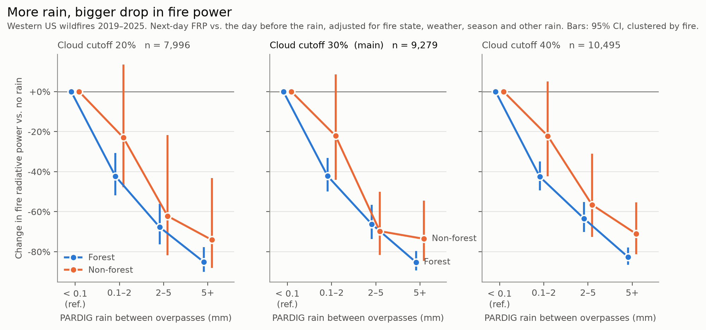

# Rain and Wildfire Power

**How much does rain suppress active wildfires based on PARDIG and IMERG?**

Western US wildfires, June–November 2019–2025. 9,279 fire-days from 1,913 fires, measured with VIIRS active-fire data, with rain from PARDIG-NRT and IMERG-Final V07 (NASA). Figures and tables are reproduced by [`analysis/results.ipynb`](analysis/results.ipynb).

## Findings

1. **More rain, bigger drop in fire power.** After 5 mm or more of rain, a forest fire's radiative power the next day is **85% lower** [80–89%] than after a dry day, adjusted for the fire's state, weather, season and other rain. After 2–5 mm it's 66% lower, and after 0.1–2 mm 42% lower. Non-forest fires show the same pattern with wider intervals (−74% at 5+ mm).
2. **Most of the heavy-rain effect isn't just the storm's air.** A storm also brings cooler, more humid air. Holding post-storm temperature and humidity fixed, which makes this a lower bound, 5+ mm still cuts forest fire power by at least **74%** [66–81%]. For light rain, most of the drop comes along with the air (−18% with it held fixed).
3. **PARDIG rain predicts fire response better than IMERG.** On fires held out of training (5-fold cross-validation grouped by fire), adding PARDIG rain improves prediction **1.4× as much** as adding IMERG-Final rain (held-out R² gain 0.038 vs 0.028). PARDIG's error is lower in 100% of fire-level bootstrap resamples (98% at the strictest cloud cutoff), and PARDIG is ahead at every cutoff (1.3–1.4×). It is a consistency check: fire response is an indirect signal of rainfall, not ground truth.



## Method

- **Fires.** VIIRS detections (Suomi-NPP and NOAA-20, 375 m) were filtered and clustered into fire events.
  - Static industrial sources were removed with a 1 km buffer around any FIRMS type-2 detection, because the type field is unreliable. Locations active in at least 6 months across at least 3 years were also dropped.
  - Clustering used 2 km within a day, with a 5-day lookback to link days.
  - Spot checks match reported fires: Dixie 2021 at ~955k vs 963k acres, Creek 2020 at ~407k vs 380k.
- **Unit.** One fire × one day. Fire power before (the two daytime overpasses before the rain window) is compared with fire power after (the two after it). The rain window runs between overpasses, not UTC days, so afternoon storms aren't split.
- **Outcome.** log((FRP_after + c) / (FRP_before + c)), shown as % change.
- **Clouds.** VIIRS can't see through cloud, and a hidden fire would read as "fire went out." Overpasses with ERA5 cloud cover of 30% or more over the fire are dropped, and each period needs at least 2 clear looks.
- **Rain.** Footprint-mean totals during the rain window, with each 15- or 30-minute image weighted by its overlap with the window. Rain before, after and in the week before the window are controls.
- **Model.** OLS of the outcome on rain bin × fuel (forest vs. non-forest, NLCD from the year before the fire). Controls: fire power before, detection count, pre-rain trend, fire age, pixel size, temperature, humidity, VPD, wind and month. Standard errors are clustered by fire.

## Robustness

The curve is unchanged at cloud cutoffs of 20, 30 and 40%. Rain falling *after* the measurement shows no effect (placebo), so the curve isn't a weather-pattern artifact. Controlling for cloud cover leaves both the curve and PARDIG's edge over IMERG unchanged (1.41× with the control). The placebo, cloud-control and held-out comparisons were added after the main results were seen. Further checks (detection loss vs. cloud cover, PARDIG at 30-minute resolution, snow) are in the [notebook](analysis/results.ipynb).

## Claim

Cloud screening keeps only fire-days with clear looks before and after the rain: about 1 in 5 with 2 mm or more, and 1 in 3 with lighter rain. The kept windows have the same rain totals as the dropped ones in each bin. But they're shorter storms (heavy rain: 4.2 h vs 5.8 h) and less often in autumn (7% vs 17% in Oct–Nov). **The results describe mostly summer storms of a few hours, falling between clear days.** Long autumn frontal storms are under-represented. Firefighting effort is unobserved. PARDIG is an experimental dataset.

## Data sources

- **PARDIG-NRT**: Google DeepMind and Google Research ([CC BY 4.0](https://creativecommons.org/licenses/by/4.0/))
- **IMERG-Final V07**: NASA GPM
- **VIIRS active fire**: NASA [FIRMS](https://firms.modaps.eosdis.nasa.gov/)
- **ERA5**: contains modified Copernicus Climate Change Service information (2026)
- **NLCD**: U.S. Geological Survey
- **State boundaries**: U.S. Census Bureau

Gridded data were accessed through Google Earth Engine. The data providers don't endorse this analysis.

---

## Reproducing

```
uv sync
uv run earthengine authenticate   # then set PROJECT in extract/ee_common.py to your Earth Engine Cloud project
```

FIRMS yearly country files (VIIRS S-NPP and NOAA-20, United States, 2019–2025) go in `data/raw/firms/`. Census state boundaries go in `data/raw/states/` ([cb_2023_us_state_20m.zip](https://www2.census.gov/geo/tiger/GENZ2023/shp/cb_2023_us_state_20m.zip)).

| Step | Command                                                              | Output                                                    |
| ---- | -------------------------------------------------------------------- | --------------------------------------------------------- |
| 1    | `uv run python process/events.py`                                    | fire events → `data/interim/`                             |
| 2    | `uv run python process/check_events.py`                              | sanity checks → `data/interim/checks/`                    |
| 3    | `uv run python process/windows.py`                                   | observations and windows → `data/interim/`                |
| 4    | `uv run python extract/rain.py` (~10 min)                            | PARDIG and IMERG rain per interval                        |
| 5    | `uv run python extract/rain_duration.py`, `extract/rain_pardig30.py` | rain duration, 30-min PARDIG                              |
| 6    | `uv run python extract/landcover.py` (~8 min)                        | NLCD fuel, cropland share                                 |
| 7    | `uv run python extract/era5.py` (~2 min)                             | cloud cover per overpass, weather                         |
| 8    | `uv run python process/assemble.py`                                  | `data/final/analysis.parquet`, `cloud_validation.parquet` |
| 9    | `uv run python analysis/checks.py`                                   | Figure 2, Table 1 (no outcome used)                       |
| 10   | `uv run python analysis/models.py`                                   | Figure 1, Table 2, all estimates                          |
| 11   | `uv run python analysis/robustness.py`                               | post-results checks                                       |

Or run steps 9–11 at once with the notebook `analysis/results.ipynb`. Earth Engine steps cache each batch in `data/interim/ee/` and resume if interrupted. Tests: `uv run pytest -q tests`.

Layout: `extract/` pulls data from Earth Engine; `process/` builds the analysis table; `analysis/` fits models and makes figures from `data/final/` only.
